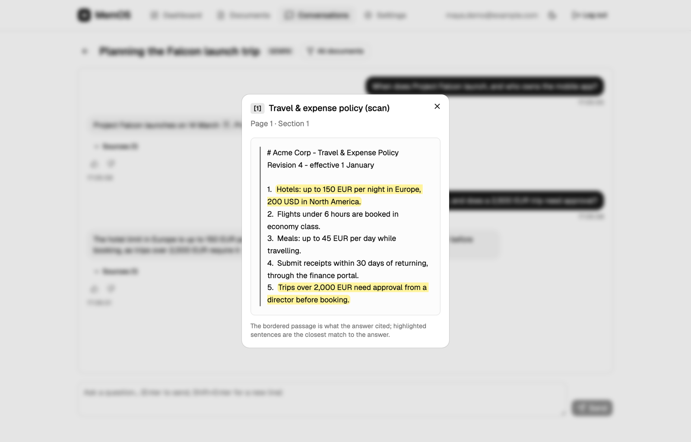
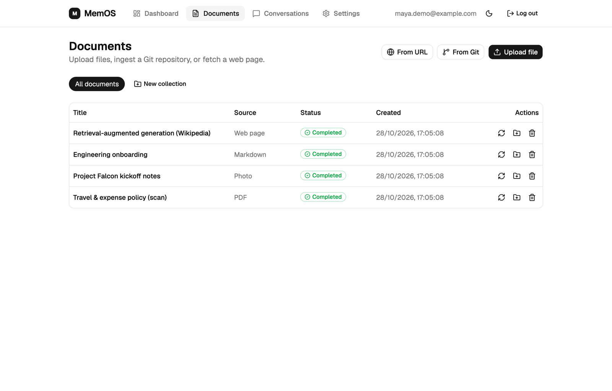
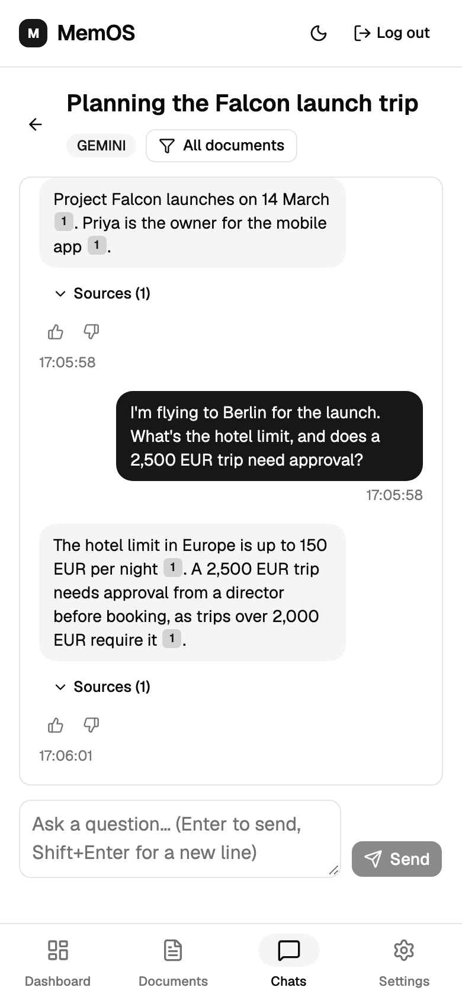
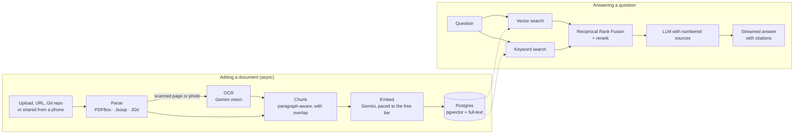

# MemOS

**Ask questions about your own documents, notes and saved pages, and get answers that cite the exact passage they came from.**

[**Try it live →**](https://memos-ai.byte-phantom.workers.dev) &nbsp;·&nbsp; Java 21 · Spring Boot · Postgres + pgvector · Redis · React



*The answer above comes from a **scanned PDF** with no text layer. MemOS read it with OCR, found the right passage, and highlights the sentences the answer is based on.*

## What it does

- **Add almost anything.** PDFs, Markdown or text files, web pages, whole Git repositories, **photos of handwritten notes** and **scanned documents**.
- **Ask in plain language.** Answers stream in as they're written, and every claim links to its source. Click a citation to see the passage, with the matching sentences highlighted.
- **Honest when it doesn't know.** If your documents don't contain the answer, it says so instead of making one up.
- **Save from any app.** On Android, MemOS installs as an app and appears in the share menu: share a link, a file or a photo straight into it.
- **Organize and focus.** Group documents into collections, and limit a conversation to one collection or a few documents.
- **Works on phones.** The layout is responsive, with a bottom tab bar on small screens.

<p>
  
  &nbsp;
  
</p>

## How it works



## Engineering decisions

**Hybrid retrieval.** Vector search is good at meaning but misses exact terms like names, error codes and numbers. MemOS runs pgvector similarity search and Postgres full-text search side by side, merges the two rankings with **Reciprocal Rank Fusion**, then reranks by word overlap with the question.

**Grounded answers.** Retrieved passages are numbered in the prompt, and the model must cite them as `[n]`. When nothing relevant is found, it returns a "not found" answer instead of guessing. Users can rate answers, and a dashboard lists the ones marked unhelpful.

**Resumable, crash-safe ingestion.** Ingestion runs asynchronously with live progress. Each chunk's embedding is cached in Redis, so retrying a failed document skips the work already done, and uploads are kept on disk until ingestion succeeds. Documents stuck mid-ingestion after a restart are detected and marked failed so they can be retried.

**OCR without native dependencies.** Photos and scanned PDF pages are read with Gemini's vision model rather than a classic OCR engine. It handles handwriting and phone photos much better and needs no native libraries on the server. Only pages that contain an image and no text are sent, calls are paced under the free tier's rate limit, and each document is capped at 30 OCR pages.

**Built for free-tier limits.** It runs entirely on free plans: a 512 MB backend (Render), serverless Postgres (Neon), Redis (Upstash) and the frontend on Cloudflare Workers. Embeddings are sent in small batches paced to Gemini's tokens-per-minute quota. Per-user limits on questions, ingestions and storage stop one account from using up the shared AI quota.

**Security.**
- **Sign-up:** new accounts verify their email with a single-use 6-digit code, and the sign-up form doesn't reveal which emails already have accounts.
- **Sessions:** JWT access tokens last 15 minutes. Refresh tokens are rotated on every use and stored only as hashes. Users can log out of all devices.
- **Login:** attempts are rate-limited per account, and unknown emails take as long to reject as wrong passwords, so timing doesn't reveal which accounts exist.
- **Account changes:** changing your email or password requires the current password.
- **Server-side request forgery:** URL and Git imports resolve the host and refuse private and local addresses, checking every redirect too. Otherwise a user could make the server read internal services and see the results through chat.
- **Browser:** the frontend sends a strict Content-Security-Policy and other security headers.

**Hexagonal architecture.** The code is split into `domain` (models and ports, no framework), `application` (use cases), `infrastructure` (adapters for Postgres, Redis, AI providers, parsers, email) and `web` (REST). Adding a source type means adding a parser and an enum value; the ingestion pipeline doesn't change. Gemini, OpenAI and Claude sit behind the same chat port.

## Tech stack

| | |
|---|---|
| **Backend** | Java 21, Spring Boot 3.4, Spring Security (JWT), Spring AI, Flyway |
| **Data** | PostgreSQL + pgvector (HNSW index), Postgres full-text search, Redis |
| **AI** | Gemini for chat, embeddings and OCR by default; OpenAI and Claude adapters |
| **Parsing** | PDFBox, Jsoup, JGit, CommonMark |
| **Frontend** | React 19, TypeScript, Vite, Tailwind CSS 4, shadcn/ui, TanStack Query; installable PWA |
| **Email** | Brevo HTTP API |
| **Testing** | JUnit 5, Mockito, MockMvc, Testcontainers (real pgvector); GitHub Actions CI |
| **Hosting** | Render, Neon, Upstash, Cloudflare Workers, all on free plans |

## Running locally

**Prerequisites:** Java 21, Docker, Node 22, and a free [Gemini API key](https://aistudio.google.com/apikey).

```bash
# 1. Configure: set GEMINI_API_KEY and JWT_SECRET (openssl rand -base64 64)
cp .env.example .env

# 2. Start Postgres (with pgvector) and Redis
docker compose up -d postgres redis

# 3. Start the backend on http://localhost:8080 (database migrations run automatically)
set -a; source .env; set +a
DB_HOST=localhost REDIS_HOST=localhost ./mvnw spring-boot:run

# 4. Start the frontend on http://localhost:3000
cd frontend && npm install && npm run dev
```

Without email configured, sign-up codes and password-reset links are printed in the backend log. API docs are at `http://localhost:8080/swagger-ui.html`.

## Deploying

- **Free, no server:** [docs/deploy-free.md](docs/deploy-free.md) covers Render, Neon, Upstash and Cloudflare Workers (`render.yaml` and `frontend/wrangler.jsonc`).
- **Single server:** [docs/deploy-oracle.md](docs/deploy-oracle.md) runs the whole stack with `docker-compose.prod.yml`: Postgres, Redis, backend, frontend and Caddy with automatic HTTPS, plus nightly backups.

## API

Everything is under `/api/v1`, and every endpoint except `/auth/**` needs `Authorization: Bearer <token>`. The full reference is in Swagger UI.

| Area | Endpoints |
|---|---|
| **Auth** | `POST /auth/register` (emails a code) · `POST /auth/register/verify` · `POST /auth/login` · `POST /auth/refresh` · `POST /auth/logout` · `POST /auth/password-reset/request` · `POST /auth/password-reset/confirm` |
| **Account** | `GET`/`PATCH /users/me` · `POST /users/me/logout-everywhere` |
| **Documents** | `POST /documents/upload` · `POST /documents/url` · `POST /documents/git` · `GET /documents` · `GET /documents/{id}/progress` · `POST /documents/{id}/retry` · `POST /documents/{id}/reingest` · `DELETE /documents/{id}` |
| **Conversations** | `POST /conversations` · `POST /conversations/{id}/messages` · `POST /conversations/{id}/messages/stream` (SSE) · `PATCH /conversations/{id}/scope` · `PUT /conversations/{id}/messages/{messageId}/feedback` |
| **Other** | `/collections` · `/feedback` · `/stats` |

## Testing

```bash
./mvnw verify                          # unit, web-layer and Testcontainers integration tests (needs Docker)
cd frontend && npm run lint && npm run build
```

Both run in GitHub Actions on every push. The integration tests run the real retrieval queries against `pgvector/pgvector` in a container.

## Limitations and next steps

- **Retrieval evaluation.** Next up: a fixed set of questions with known answers, scored with recall@k and MRR, so retrieval changes are measured rather than eyeballed. One known weak spot it should capture is a single question that spans two unrelated documents, where often only one of them is retrieved.
- **Email changes aren't verified yet.** Sign-up verifies the address, but changing it later only asks for the password.
- **Sharing works on Android only.** iPhone Safari doesn't support web share targets; on iPhone, the upload button opens the camera instead.
- **Embedding dimensions are fixed** at 768 (Gemini). Switching to another embedding provider needs a migration and re-embedding everything.
