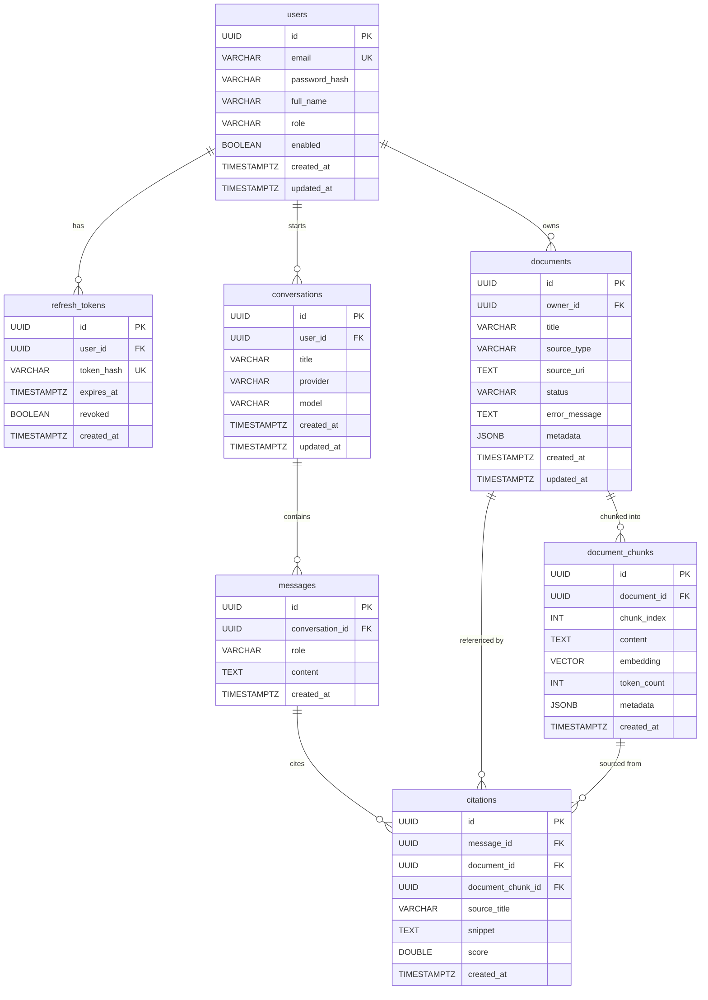

# MemOS — Entity Relationship Diagram

## Relationships

| From | To | Cardinality | Description |
|---|---|---|---|
| `users` | `refresh_tokens` | 1 → many | Each user can have multiple active refresh tokens |
| `users` | `documents` | 1 → many | A user owns all the documents they upload/ingest |
| `users` | `conversations` | 1 → many | A user can have multiple RAG conversations |
| `documents` | `document_chunks` | 1 → many | Each document is split into text chunks with embeddings |
| `conversations` | `messages` | 1 → many | A conversation holds an ordered history of messages |
| `messages` | `citations` | 1 → many | An assistant reply can cite multiple chunks |
| `documents` | `citations` | 1 → many | A document can be cited across multiple messages |
| `document_chunks` | `citations` | 1 → many | A specific chunk can be cited across multiple messages |

## Notes

- `document_chunks.embedding` is a `vector(768)` column (pgvector). Dimensionality is fixed for Gemini `text-embedding-004`. Switching providers requires a migration + full re-embedding.
- `citations` is a three-way join between a `message`, the `document` it came from, and the exact `document_chunk` that was retrieved — preserving full traceability of every RAG answer.
- All foreign keys use `ON DELETE CASCADE`, so deleting a user removes all their data; deleting a document removes its chunks and any citations referencing those chunks.
- `source_type` on `documents` is one of `PDF`, `MARKDOWN`, `GIT_REPOSITORY`.
- `role` on `messages` is one of `USER`, `ASSISTANT`.
- `provider` on `conversations` is one of `GEMINI`, `OPENAI`, `CLAUDE`.
